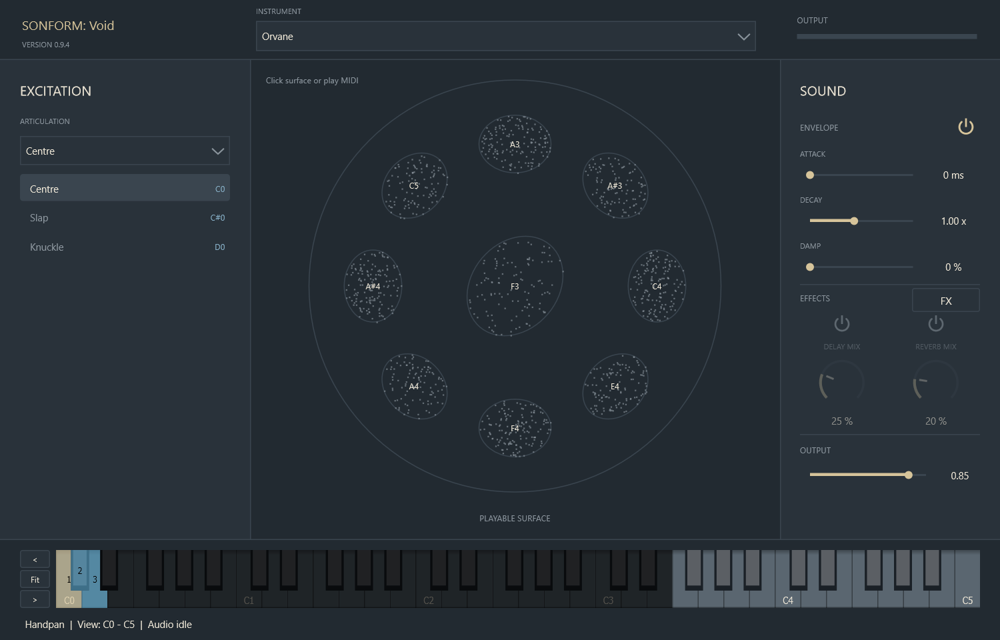

# SONFORM Void

[中文](README.md) · **English**

SONFORM Void is a physically modeled handpan and tongue-drum instrument by WTdusk. Strike position, velocity, and articulation shape the attack and resonance. Play handpan melodies, metallic percussion patterns, or layers of sustained resonance.

**Windows x64 · VST3 and standalone · GNU AGPL-3.0-only**

[Download 0.9.4](https://github.com/WTdusk/sonform-void/releases/tag/v0.9.4) · [Release notes](RELEASE.md#english) · [Playing guide (Chinese)](Hand%20Pan%20Modeling/plugin/README.md)



## Models and performance

- The **seven models** are Orvane, Gravik, Nuvora, Virel, Serevin, Tembrel, and Somera. Each has its own range, note layout, and articulation list.
- Click the instrument zones, use the on-screen keyboard, or connect a MIDI controller. The on-screen keyboard also marks articulation keyswitches.
- Adjust attack, decay, and damping, then use the effects panel for processing such as delay, reverb, and granular effects.

## Install and play

1. Download the Windows installer from the [0.9.4 release](https://github.com/WTdusk/sonform-void/releases/tag/v0.9.4). Select VST3, standalone, or both, and choose an installation folder for each selected component.
2. For **VST3**, select a folder your DAW scans, rescan plug-ins, and load SONFORM Void on an instrument track. For **standalone**, launch SONFORM Void from the Start menu and choose your audio device and MIDI input under Settings.
3. Pick a model and an articulation. Click the instrument zones to audition sounds, or play them from a MIDI keyboard.

For manual installation, extract the ZIP and copy the entire `SONFORM Void.vst3` folder into your DAW’s VST3 scan path. To run the standalone version, launch its EXE from the extracted folder.

## Build from source

On Windows, install PowerShell 7, CMake, and Visual Studio with the **Desktop development with C++** workload. Run this from the repository root to build VST3 and standalone and run the tests.

```powershell
& '.\Hand Pan Modeling\build-plugin.ps1'
```

See the [build and packaging guide (Chinese)](Hand%20Pan%20Modeling/README.md) to create the installer and manual ZIP. When reporting an issue, include the Windows version, DAW and version, plug-in format, and steps to reproduce it.

## License

SONFORM Void is developed by **WTdusk** and licensed under [GNU AGPL-3.0-only](LICENSE.md). JUCE 9.0.2 is used under [its AGPLv3 option](JUCE-9.0.2/LICENSE.md), and bundled dependencies retain their own notices. The Windows installer and ZIP include the corresponding source code.
