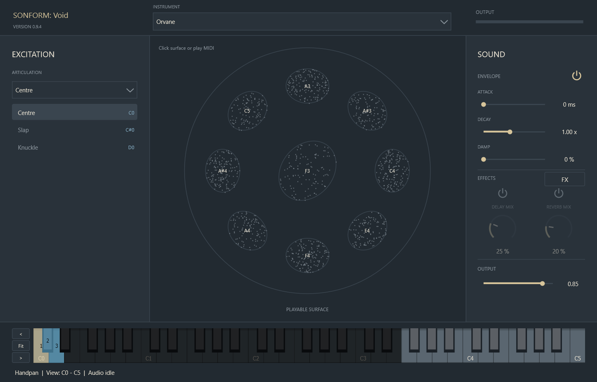

# SONFORM Void

**中文** · [English](README.en.md)

SONFORM Void 是 WTdusk 开发的手碟与舌鼓物理建模音源。它根据击打位置、力度和奏法计算起音与共振，可用于演奏手碟旋律、金属打击节奏和持续共鸣的音色层。

**Windows x64 · VST3 与独立版 · GNU AGPL-3.0-only**

[下载 0.9.4](https://github.com/WTdusk/sonform-void/releases/tag/v0.9.4) · [版本说明](RELEASE.md) · [安装与演奏手册](Hand%20Pan%20Modeling/plugin/README.md)



## 音色与演奏

- **七款模型**包括 Orvane、Gravik、Nuvora、Virel、Serevin、Tembrel 和 Somera。各模型有独立的音域、音区布局和奏法列表。
- 点击界面上的音区、点击屏幕键盘，或使用 MIDI 控制器。屏幕键盘也标出可切换奏法的按键。
- 调节起音、衰减和阻尼。可在效果面板中进一步使用延迟、混响和粒子效果等处理。

## 安装与上手

1. 在 [0.9.4 下载页](https://github.com/WTdusk/sonform-void/releases/tag/v0.9.4) 下载 Windows 安装程序，勾选 VST3、独立版或两者，并分别选择安装目录。
2. **VST3** 安装到宿主会扫描的目录，安装后在宿主中重新扫描，并在乐器轨道加载 SONFORM Void。**独立版**可从开始菜单启动，在 Settings 中选择音频设备和 MIDI 输入。
3. 从型号菜单选一个音色，再选择奏法。可以先用鼠标点击乐器音区试听，再接入 MIDI 键盘。

也可以下载 ZIP 手动安装。请先解压，将完整的 `SONFORM Void.vst3` 文件夹放入宿主的 VST3 目录，或直接运行解压后的独立版 EXE。

## 从源码构建

在 Windows 上准备 PowerShell 7、CMake 和 Visual Studio 的「使用 C++ 的桌面开发」工作负载。在仓库根目录运行以下命令，构建 VST3 和独立版并运行测试。

```powershell
& '.\Hand Pan Modeling\build-plugin.ps1'
```

制作安装程序及手动 ZIP 的方法见 [构建与打包指南](Hand%20Pan%20Modeling/README.md)。提交问题时，可以附上 Windows 版本、宿主及版本、插件格式和复现步骤。

## 许可

SONFORM Void 由 **WTdusk** 开发，项目源码采用 [GNU AGPL-3.0-only](LICENSE.md)。JUCE 9.0.2 通过 [其 AGPLv3 许可选项](JUCE-9.0.2/LICENSE.md) 使用，随附依赖保留各自的许可声明。Windows 安装程序和 ZIP 均附带对应源码。
